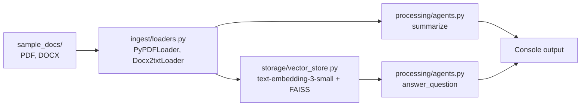

# Document Q&A Starter (RAG)

A minimal retrieval-augmented generation starter: load PDF and Word documents, embed them into a FAISS index, then summarize them and answer questions with an OpenAI model.

**Status:** small learning scaffold, about 80 lines of working code. The `ui/` and `workflows/` modules are empty placeholders.

## How it works



| File | What it does |
|---|---|
| `main.py` | Runs the flow end to end on `sample_docs/` and asks one sample question |
| `ingest/loaders.py` | Loads every `.pdf` and `.docx` in a folder into LangChain documents |
| `storage/vector_store.py` | Builds an in-memory FAISS index with OpenAI embeddings |
| `processing/agents.py` | `summarize(docs)` and `answer_question(vectordb, question)` using the OpenAI chat API |
| `ui/app.py`, `workflows/contract_flow.py` | Empty. Reserved for a Streamlit UI and a multi-step workflow |

## Setup

```bash
python -m venv .venv && source .venv/bin/activate   # Windows: .venv\Scripts\activate
pip install langchain-community langchain-openai openai faiss-cpu pypdf docx2txt python-dotenv
```

`requirements.txt` is a full environment freeze and installs far more than the code uses. The command above installs only what is imported.

Create a `.env` file:

```env
OPENAI_API_KEY=sk-...
MODEL=gpt-4o-mini
```

## Usage

Put one or more PDF or DOCX files in `sample_docs/`, then:

```bash
python main.py
```

It prints a summary of the documents and an answer to "What are the payment terms?". Change the question in `main.py`.

## Limitations

- No chunking: each loaded page or document is embedded whole
- The index is rebuilt in memory on every run
- No tests, no UI, no agent loop yet despite the repository name
- `summarize` sends all document text in one request, so large files will exceed the model's context window

## Next steps

- Text splitting before embedding
- Persist the FAISS index
- Fill in the Streamlit UI and the contract workflow
